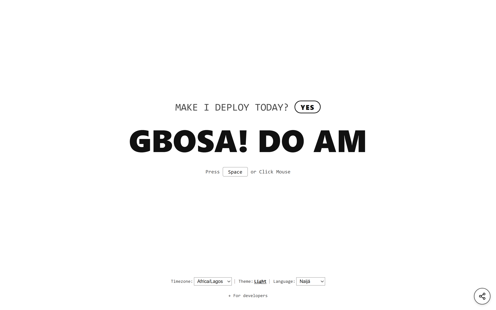
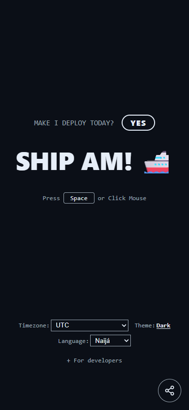
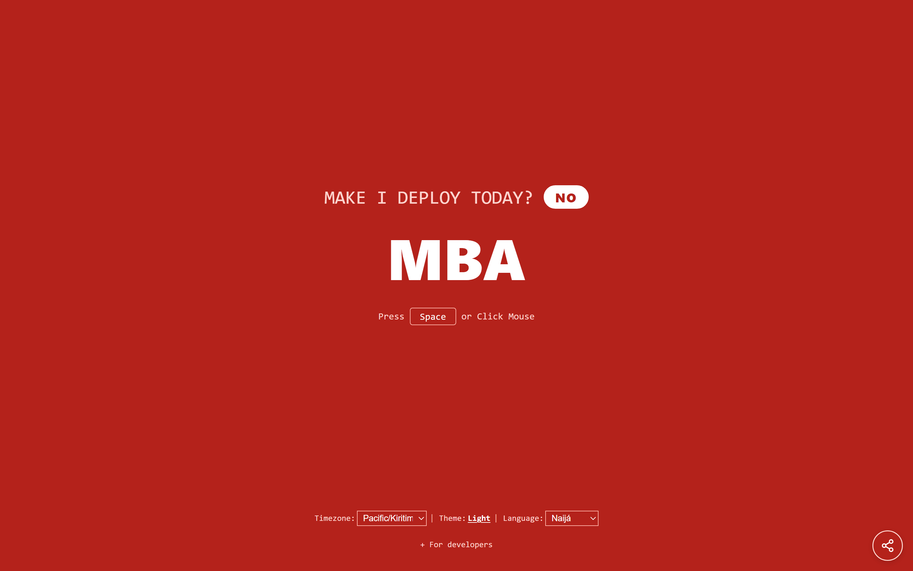
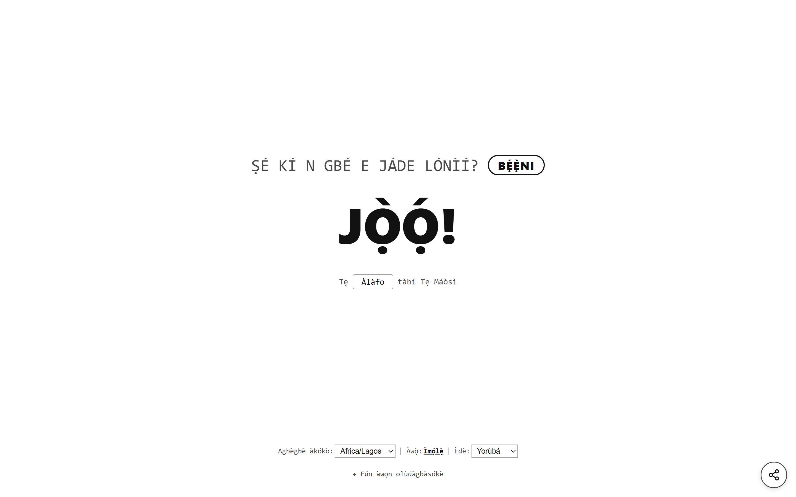

# [makeideploy.today]

FOSSA Status - [fossa-url]
FOSSA License Badge - [fossa-license-badge]
FOSSA Security Badge - [fossa-security-badge]

## Wetin Dis Repo Be About 🚀

Dis na Pidgin English version of "shouldideploy" repo. We dey try make developers, designers, and tech people laugh small before dem deploy code.

### See Am For Yourself 👀

<table>
  <tr>
    <td width="68%"></td>
    <td width="32%" rowspan="2"></td>
  </tr>
  <tr>
    <td></td>
  </tr>
  <tr>
    <td colspan="2"></td>
  </tr>
</table>

E go answer you straight, YES or NO, then give you reason wey go make you laugh. When e be NO, the whole page go turn red. Light or dark (e go follow your phone setting), phone or laptop, and e dey speak seven languages: Pidgin, Swahili, Yoruba, Igbo, Hausa, Zulu and Amharic. Press the round button for corner to share your answer with your people. Go try am live for [makeideploy.today].

### How We Dey Roll 💻

- We dey speak pure pidgin
- We dey welcome contributions wey dey speak pidgin
- No serious grammar, just vibes and code 😎

### You Fit Contribute? 🤝

- Fork the repo
- Add your pidgin magic
- Make pull request
- Make everybody laugh small 😂

### Rules Wey Simple

- Write code wey work
- Use pidgin wey everybody go understand
- No form grammar, just flow

**Abeg, come join us make we laugh and code!** 🇳🇬🖥️

## Getting started

- Run dis tin:
  - `npm i` — make dependencies enter.
  - `npm run dev` start dev server. E go use port 3000, and if another app don hold am, Next go find the next free port (look the terminal for the URL). You fit choose your own: `PORT=4000 npm run dev` (PowerShell: `$env:PORT=4000; npm run dev`).
  - `now dev` if you want use local serveless function (you go need "now")

  ## Vercel Analytics (Next.js) — Quick setup

  To start counting visitors and page views with Vercel Analytics:

  1. Install the package:

  ```bash
  npm i @vercel/analytics
  ```

  2. Add the Analytics component to your app layout (we added it to `pages/_app.tsx`):

  ```ts
  import { Analytics } from '@vercel/analytics/next'

  function App({ Component, pageProps }) {
    return (
      <>
        <Component {...pageProps} />
        <Analytics />
      </>
    )
  }
  ```

  3. Deploy to Vercel and visit your site. Data should appear in the Vercel Analytics dashboard within ~30 seconds.

  Notes:
  - If you don't see data, check content blockers and navigate between pages to trigger pageviews.
  - Vercel Analytics is designed for quick dashboards and insights — it does not provide raw event exports from the Vercel dashboard.

  ## Retrieving or exporting analytics data

  There is no official public API or raw-event export for Vercel Analytics that you can query outside the Vercel app. If you need exportable, event-level data for a case study, use one of these options instead:

  - **GA4 + BigQuery** — let GA4 collect events and enable BigQuery export for raw events and SQL analysis.
  - **PostHog** (self-hosted or cloud) — event-level tracking with CSV/SQL export and product analytics features.
  - **Plausible** — privacy-friendly with CSV exports for simple reports.
  - **Custom collector** — add a small tracking script that sends events to your own serverless API (Supabase/Postgres/BigQuery). This gives you full control and immediate CSV/SQL export.

  If you want, I can add a minimal serverless `/api/track` handler and a small client script to persist `clientId` and events for export-ready data.

## 🧩 Chrome Extension

Na quick way to check if you suppose deploy without opening browser website.

### Setup for Development

```bash
npm run generate:icons  # Create extension icons
```

Then:
1. Go to `chrome://extensions/`
2. Enable Developer mode (toggle top right)
3. Click "Load unpacked" 
4. Select the `extension` folder
5. Done! Icon go appear for you

### Package for Chrome Web Store

```bash
npm run build:extension  # Create ZIP file for submission
```

See full documentation: [extension/README.md](extension/README.md) and [extension/QUICKSTART.md](extension/QUICKSTART.md)

## Add your reasons

Reasons dey inside the locale JSON files for `locales/` folder (e.g. `locales/pcm.json`, `locales/sw.json`). Edit the file wey match your language.

## API endpoint

We get API wey you fit use for your CI or just for fun at [api-endpoint].

You fit add some optional parameters wey go customize API response:

- `tz`: Timezone wey you want use. Put correct timezone string, like `Africa/Lagos` or `America/Chicago`. Default na `UTC`.

- `date`: Date wey you want check. Default na today. Put correct date string for this format `YYYY-MM-DD`, like `2024-11-18`.

- `lng`: Language/locale wey you want. Supported values: `pcm`, `sw`, `yo`, `ig`, `ha`, `zu`, `am`. Default na `pcm`.

### Examples

Get the default API response using the current date and time in the UTC timezone:

```url
https://makeideploy.today/api
```

Get the API response for a specific timezone (e.g., Africa/Lagos):

```url
https://makeideploy.today/api?tz=Africa/Lagos
```

Get the API response for a specific date (e.g., 2024-11-18) in the UTC timezone:

```url
https://makeideploy.today/api?date=2024-11-18
```

Get the API response for a specific date (e.g., 2024-11-18) in a specific timezone (e.g., America/Chicago):

```url
https://makeideploy.today/api?tz=America/Chicago&date=2024-11-18
```

Get the API response in Swahili:

```url
https://makeideploy.today/api?tz=Africa/Nairobi&lng=sw
```

## API Response

The API go give you JSON object wey get these keys:

- `timezone`: Timezone wey you give for the request.
- `date`: Date wey you provide for ISO format (YYYY-MM-DDTHH:mm:ss.sssZ).
- `lng`: Language/locale wey dey active.
- `tagline`: App tagline for that locale.
- `makeideploy`: Boolean value wey go show if you suppose deploy today.
- `color`: Hex color wey match current deploy status.
- `message`: String/Message wey explain why you go or no go deploy.

Example response:

```json
{
  "timezone": "UTC",
  "date": "2024-11-18T00:00:00.000Z",
  "lng": "pcm",
  "tagline": "Make I Deploy Today?",
  "makeideploy": false,
  "color": "#ff4136",
  "message": "Today na Monday, you suppose don deploy!"
}
```

## Credits

Favicon created by **emilegraphics** from the NOUN Project at [favicon-credit]

## 🔐 Privacy Policy

We respect your privacy. **The application and Chrome Extension collect zero personal data.**

See our complete [PRIVACY_POLICY.md](PRIVACY_POLICY.md) for details on:
- What data is collected (none for personal info)
- How API calls work
- Your data rights and our security practices

## License

Abeg check am for [license-link] || WTFPL - You fit do anytin wey you want with dis code!

- [makeideploy.today]: https://makeideploy.today
- [fossa-security-badge]: https://app.fossa.com/api/projects/git%2Bgithub.com%2FIamPrime%2Fmakeideploy.svg?type=shield&issueType=security
- [fossa-url]: https://app.fossa.com/projects/git%2Bgithub.com%2FIamPrime%2Fmakeideploy/refs/branch/master/4fb86dd32bd7365637daf5b4f689347539ab742f
- [fossa-license-badge]: https://app.fossa.com/api/projects/git%2Bgithub.com%2FIamPrime%2Fmakeideploy.svg?type=shield&issueType=license
- [reasons.ts]: https://github.com/IamPrime/makeideploy/blob/master/helpers/reasons.ts
- [api-endpoint]: https://makeideploy.today/api
- [favicon-credit]: https://thenounproject.com/search/?q=dot&i=1359410
- [license-link]: https://github.com/IamPrime/makeideploy/blob/master/LICENSE
<!-- End of README.md -->